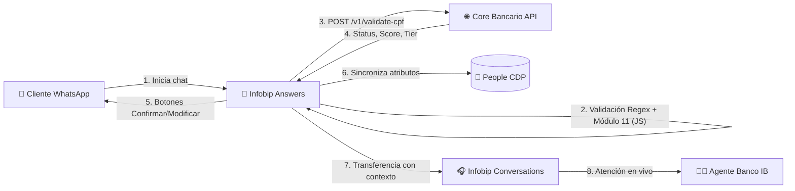
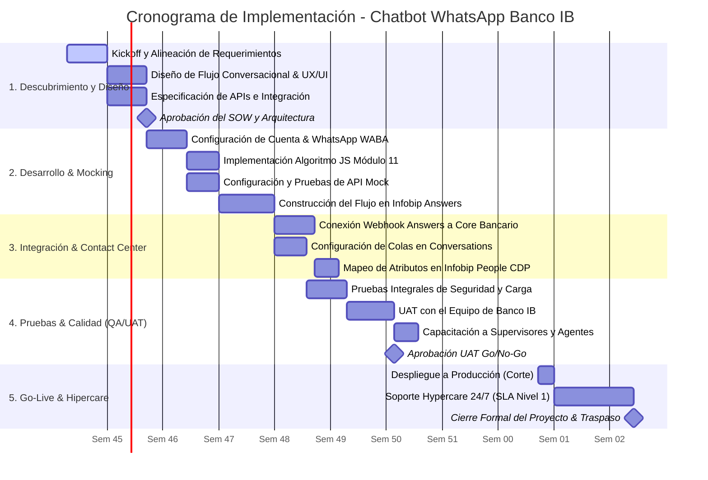

# STATEMENT OF WORK (SOW)
## Proyecto: Asistente Virtual Inteligente WhatsApp & Integración Core Bancario
### Cliente: Banco IB | Proveedor: Infobip Latam Solutions Engineering

---

| **Documento** | Statement of Work (SOW) - Banco IB |
|---|---|
| **Versión** | 1.0 - Definitivo para Producción / Demostración |
| **Fecha** | Noviembre 2026 |
| **Líder Técnico** | Solutions Engineering Lead - Infobip |
| **Patrocinador Cliente** | Vicepresidencia de Canales Digitales & Operaciones - Banco IB |

---

## 1. Resumen Ejecutivo y Contexto de Negocio

El **Banco IB** se encuentra en una etapa estratégica de modernización de su experiencia de atención al cliente. Actualmente, la demanda de consultas y onboarding por canales no asistidos experimenta tiempos de espera considerables y fricciones en la verificación de identidad. 

Para resolver este desafío, **Infobip** propone el despliegue de una solución integral basada en la plataforma **Infobip Answers** (motor de chatbots impulsado por IA y reglas conversacionales), conectada a través del canal oficial de **WhatsApp Business Platform**, con integración en tiempo real al **Core Bancario de Banco IB** para la validación crediticia y registral de CPF, y derivación contextual sin pérdida de datos hacia **Infobip Conversations** (Contact Center Omnicanal en la nube).

### Objetivos del Proyecto
* **Automatización y Eficiencia:** Automatizar el 75%+ de las consultas de validación inicial y captura de datos.
* **Seguridad y Validación Estricta:** Implementar doble anillo de validación de documento (algoritmo Módulo 11 en el perímetro conversacional + validación contra API de Core Bancario).
* **Experiencia de Usuario Superior:** Reducir el tiempo de derivación a un agente humano a menos de 5 segundos, entregando el 100% de los datos precargados en la pantalla del operador.
* **Trazabilidad y Cumplimiento:** Registro auditable de eventos en concordancia con normativas de protección de datos personales (LGPD).

---

## 2. Alcance del Proyecto (In-Scope)

### 2.1 Módulo Conversacional (Infobip Answers)
* **Canal:** WhatsApp Business API verificado con plantilla interactiva de bienvenida.
* **Validación Perimetral de CPF:**
  * Verificación de sintaxis mediante Expresión Regular (`^\d{3}\.\d{3}\.\d{3}-\d{2}$` o `^\d{11}$`).
  * Ejecución de función JavaScript nativa en el nodo perimetral aplicando el algoritmo de **Módulo 11** para verificar los 2 dígitos verificadores (DV1 y DV2) y rechazo de patrones repetidos (`111.111.111-11`, etc.).
* **Captura Progresiva de Datos:**
  * Recopilación de Nombre Completo y Correo Electrónico tras la aprobación del CPF.
* **Confirmación Interactiva:**
  * Envío de mensaje enriquecido con botones de respuesta rápida (*Quick Replies*): `[Confirmar]` y `[Modificar]`.
  * Gestión de flujo de reintento en caso de solicitar modificaciones.

### 2.2 Integración Core Bancario (Webhooks REST)
* Integración bidireccional mediante Webhook HTTPS POST al endpoint `/v1/validate-cpf`.
* Procesamiento de respuesta JSON (`status`, `score`, `client_tier`, `account_exists`).
* Bifurcación condicional en el flujo según el estatus del cliente (Aprobado, Bloqueado o Prospecto Nuevo).

### 2.3 Unificación de Datos de Cliente (Infobip People CDP)
* Creación y enriquecimiento automático del perfil del cliente indexado por número de teléfono (WhatsApp ID) y CPF.
* Persistencia de atributos personalizados: `CPF`, `Email`, `Nombre`, `Credit_Score`, `Client_Tier`.

### 2.4 Derivación Contextual (Infobip Conversations)
* Transferencia automática del hilo conversacional a la cola de atención humana especializada.
* Inyección de datos en la tarjeta del cliente (*Customer Context Card*) en la consola del agente:
  * Historial conversacional previo con el chatbot.
  * Score crediticio, nivel de cliente (*PREMIUM* / *STANDARD*) y datos de contacto confirmados.
  * Habilitación de atención simultánea y respuestas predefinidas (*Canned Responses*).

### 2.5 Tableros de Control y Analítica
* Monitoreo de indicadores en tiempo real: tasa de finalización del bot, tiempos de respuesta, tasa de caída por validación de CPF y volumen de transferencias hacia agentes humanos.

---

## 3. Elementos Fuera de Alcance (Out-of-Scope)

* Modificaciones internas en los sistemas legados o mainframes del Banco IB.
* Desarrollo de pasarelas de pago o transacciones de débito directo en esta fase.
* Integración con canales de voz o telefonía física (previstos para la Fase 2).

---

## 4. Diseño de Arquitectura de la Solución

---

## 5. Cronograma del Proyecto y Diagrama de Gantt

El proyecto contempla una duración total de **8 semanas**, estructurado en 5 etapas secuenciales:

---

## 6. Matriz de Responsabilidades (RACI)

| Actividad / Entregable | Infobip Solutions Eng. | Equipo TI Banco IB | Negocio / Canales IB |
|---|:---:|:---:|:---:|
| Diseño del flujo conversacional (Answers) | **R / A** | C | C |
| Desarrollo del script de validación JS | **R / A** | C | I |
| Exposición del endpoint de Core Bancario | C | **R / A** | I |
| Configuración de WhatsApp Business Account | **R** | A | C |
| Configuración de colas en Conversations | **R / A** | C | C |
| Pruebas de Aceptación de Usuario (UAT) | C | C | **R / A** |
| Aprobación final y Paso a Producción | C | **A** | **A** |

*Leyenda: **R** = Responsable de ejecutar, **A** = Aprobador final, **C** = Consultado, **I** = Informado.*

---

## 7. Acuerdos de Nivel de Servicio (SLA) & Seguridad

1. **Disponibilidad de la Plataforma:** 99.95% de disponibilidad mensual (*Infobip Enterprise SLA*).
2. **Latencia de Mensajería:** Tiempos de entrega de mensajes interactivos menores a 1.2 segundos.
3. **Seguridad y Cifrado:**
   * Cifrado en tránsito (TLS 1.3) y en reposo (AES-256).
   * Cifrado de extremo a extremo nativo del protocolo de WhatsApp.
   * Certificaciones: ISO 27001, SOC 2 Tipo II, PCI-DSS Nivel 1.
4. **Protección de Datos:** Cumplimiento irrestricto de las leyes de secreto bancario y protección de datos personales (LGPD en Brasil y normativas equivalentes en Latinoamérica).

---

## 8. Criterios de Aceptación del Proyecto

El proyecto se considerará formalmente aprobado cuando se verifique satisfactoriamente:
1. El chatbot solicita y valida de forma infalible el formato y la fórmula Módulo 11 de CPFs reales y de prueba.
2. La API de validación responde con código 200 y enriquece la sesión con score y categoría de cliente.
3. El usuario puede confirmar o corregir sus datos mediante botones interactivos nativos de WhatsApp.
4. Al confirmar los datos, la sesión es transferida a un agente humano en **Infobip Conversations** en menos de 5 segundos, mostrando en pantalla el CPF validado, el nombre, el email y el historial.
